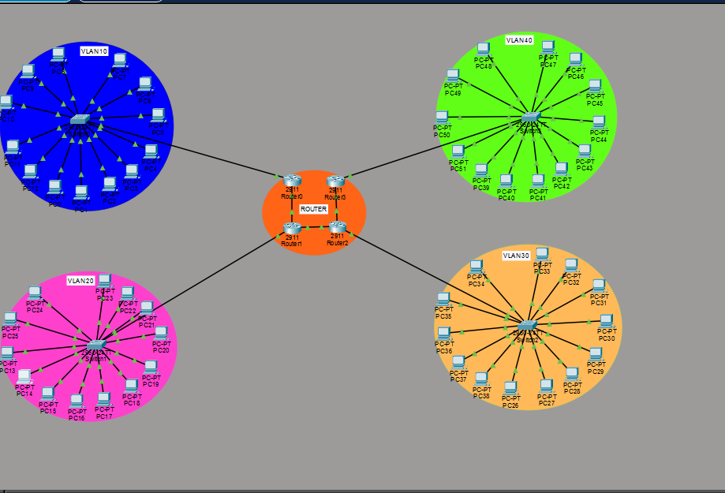
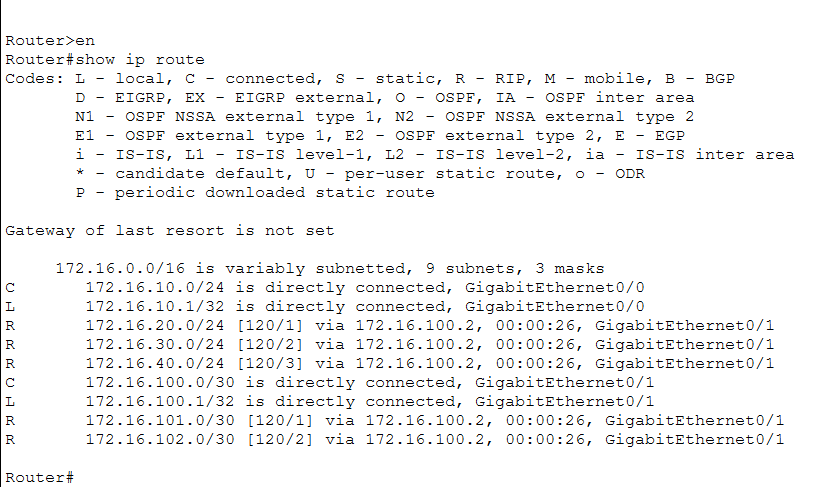
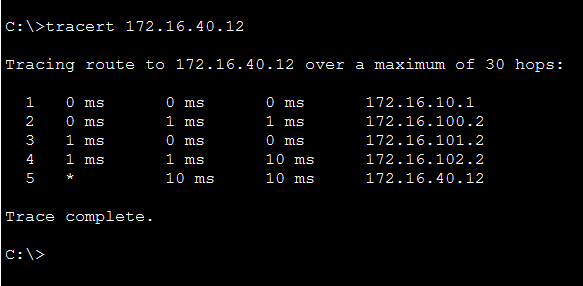

# Réseau multi-sites avec VLAN et routage RIP v2 (Cisco Packet Tracer)

## Présentation

Ce projet simule un réseau d'entreprise réparti sur **4 sites (départements)**, interconnectés par **4 routeurs** en chaîne. Chaque site possède son propre **commutateur (switch)**, son propre **VLAN** et environ **12 à 14 postes** (PC) configurés en adressage IP statique.

Le routage entre les sites est assuré dynamiquement par le protocole **RIP version 2**.

## Matériel simulé

| Équipement | Quantité |
|---|---|
| Routeurs Cisco | 4 (Router0 à Router3) |
| Commutateurs Cisco | 4 (Switch0 à Switch3) |
| PC (adressage statique) | ~50 |

## Topologie

```
Router0 --172.16.100.0/30-- Router1 --172.16.101.0/30-- Router2 --172.16.102.0/30-- Router3
   |                           |                           |                           |
Switch0 (VLAN 10)        Switch1 (VLAN 20)          Switch2 (VLAN 30)         Switch3 (VLAN 40)
```

Topologie linéaire : les liaisons entre routeurs sont des liens point à point en **/30**, et les réseaux locaux (LAN) sont en **/24**.

## Plan d'adressage

### Réseaux locaux (LAN)

| Site | VLAN | Réseau | Passerelle | Exemples de PC |
|---|---|---|---|---|
| Router0 / Switch0 | 10 | 172.16.10.0/24 | 172.16.10.1 | PC0 = .2, PC10 = .12 |
| Router1 / Switch1 | 20 (Dept20) | 172.16.20.0/24 | 172.16.20.1 | PC14 = .3, PC22 = .11 |
| Router2 / Switch2 | 30 (Dept30) | 172.16.30.0/24 | 172.16.30.1 | PC33 = .9, PC35 = .11 |
| Router3 / Switch3 | 40 (Dept40) | 172.16.40.0/24 | 172.16.40.1 | PC40 = .3, PC49 = .12 |

Masque de sous-réseau de tous les PC : `255.255.255.0`.

### Liaisons entre routeurs

| Liaison | Réseau | Côté A | Côté B |
|---|---|---|---|
| Router0 - Router1 | 172.16.100.0/30 | R0 Gi0/1 : 172.16.100.1 | R1 Gi0/1 : 172.16.100.2 |
| Router1 - Router2 | 172.16.101.0/30 | R1 Gi0/2 : 172.16.101.1 | R2 Gi0/2 : 172.16.101.2 |
| Router2 - Router3 | 172.16.102.0/30 | R2 Gi0/1 : 172.16.102.1 | R3 Gi0/1 : 172.16.102.2 |

## Configuration

### Commutateurs
- Un seul VLAN par commutateur (10, 20, 30 ou 40).
- Ports `Fa0/1` à `Fa0/14` en mode **access**, affectés au VLAN du site.
- Ports `Fa0/15` à `Fa0/24` et `Gi0/1`, `Gi0/2` inutilisés.
- Aucun trunk : chaque VLAN reste local à son commutateur.

### Routeurs
Configuration RIP identique sur les 4 routeurs :

```
router rip
 version 2
 network 172.16.0.0
```

Chaque routeur apprend automatiquement les réseaux des autres sites (routes `R` dans `show ip route`, distance administrative 120).

## Fonctionnement

Un PC du VLAN 10 (PC0, 172.16.10.2) peut joindre un PC du VLAN 40 (PC49, 172.16.40.12) :

1. PC0 envoie le paquet à sa passerelle 172.16.10.1 (Router0).
2. Router0 consulte sa table de routage (réseau 172.16.40.0/24 appris par RIP).
3. Le paquet traverse Router1, Router2, puis Router3.
4. Router3 le livre à Switch3, puis à PC49.

Il ne s'agit pas de routage inter-VLAN : chaque VLAN correspond à un réseau IP distinct derrière un routeur distinct.

## Commandes de vérification

```
show running-config
show ip interface brief
show ip route
show vlan brief
ipconfig
ping 172.16.40.12
tracert 172.16.40.12
```

## Compétences mises en œuvre

- Cisco Packet Tracer
- Adressage IPv4 statique et sous-réseaux (/24 et /30)
- VLAN et ports access
- Routage dynamique RIP v2
- Topologie multi-routeurs
- Diagnostic réseau (ping, tracert, show ip route)

## Captures d'écran

### Topologie dans Packet Tracer



### Table de routage de Router0 (show ip route)

Les routes marquées `R` sont apprises via RIP.



### Test de chemin de PC0 vers PC49 (tracert 172.16.40.12)

Le paquet traverse les 4 routeurs : 172.16.10.1, 172.16.100.2, 172.16.101.2, 172.16.102.2, puis PC49.




## Pistes d'amélioration

- Remplacer RIP par **OSPF** (RIP est limité à 15 sauts).
- Ajouter un serveur **DHCP**.
- Mettre en place du routage inter-VLAN et des **ACL**.
- Sécuriser l'accès (mots de passe, SSH, ports inutilisés désactivés).


